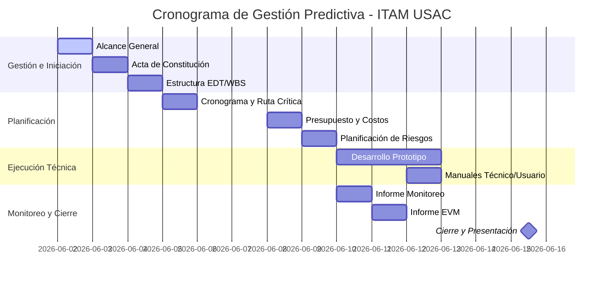

# Cronograma del Proyecto, Diagrama de Gantt y Ruta Crítica
## Proyecto: Sistema Integral de Gestión de Activos de TI (ITAM) - USAC

---

## 1. Tabla de Hitos y Entregables de Gestión

El proyecto está diseñado para completarse en un ciclo acelerado de **2.5 semanas** durante el periodo de vacaciones.

| Código Actividad | Actividad | Duración (Días) | Predecesor | Responsable | Fecha Inicio | Fecha Fin |
| :---: | :--- | :---: | :---: | :--- | :--- | :--- |
| **A** | Definición del Alcance General | 1 | - | Project Manager | 02/Jun/2026 | 02/Jun/2026 |
| **B** | Desarrollo del Acta de Constitución | 1 | A | Grupo Completo | 03/Jun/2026 | 03/Jun/2026 |
| **C** | Creación de EDT/WBS | 1 | B | Project Manager | 04/Jun/2026 | 04/Jun/2026 |
| **D** | Cronograma y Ruta Crítica | 1 | C | Project Manager | 05/Jun/2026 | 05/Jun/2026 |
| **E** | Presupuesto y Plan de Recursos | 1 | D | Analista Financiero| 08/Jun/2026 | 08/Jun/2026 |
| **F** | Planificación de Riesgos | 1 | E | Analista Riesgos | 09/Jun/2026 | 09/Jun/2026 |
| **G** | Desarrollo de Prototipo Técnico | 3 | F | Líder Técnico & DB| 10/Jun/2026 | 12/Jun/2026 |
| **H** | Informe de Monitoreo y Control | 1 | F | QA & Auditor | 10/Jun/2026 | 10/Jun/2026 |
| **I** | Informe de Desempeño EVM | 1 | E, H | Project Manager | 11/Jun/2026 | 11/Jun/2026 |
| **J** | Redacción de Manuales (Usuario/Téc) | 1 | G | Grupo Completo | 12/Jun/2026 | 12/Jun/2026 |
| **K** | Presentación Final y Cierre | 1 | I, J | Grupo Completo | 15/Jun/2026 | 15/Jun/2026 |

---

## 2. Diagrama de Gantt (Mermaid)

El siguiente diagrama ilustra la secuencia de las tareas del proyecto:

---

## 3. Identificación de la Ruta Crítica
La **Ruta Crítica** representa la secuencia de actividades que determina la duración total del proyecto. Cualquier retraso en estas tareas demorará directamente la entrega final.

Al analizar la red de actividades con el método del camino crítico (CPM):
* **Ruta de Control de Gestión:** A -> B -> C -> D -> E -> F -> G -> J -> K
* **Duración de Ruta:** 11 días laborales.
* **Holgura:** Las actividades **H** (Informe de Monitoreo) e **I** (EVM) tienen holguras de hasta 1 y 2 días respectivamente, por lo que pueden tener variaciones menores sin alterar la entrega del proyecto el 15 de junio. Sin embargo, el **Desarrollo del Prototipo (G)** y los **Manuales (J)** están en la ruta crítica con holgura cero.
