```mermaid
graph TD
    Root["1.0 Sistema ITAM USAC"] --> P1["1.1 Iniciación"]
    Root --> P2["1.2 Planificación"]
    Root --> P3["1.3 Diseño y Desarrollo"]
    Root --> P4["1.4 Pruebas y Control"]
    Root --> P5["1.5 Cierre y Entrega"]

    P1 --> P11["1.1.1 Acta de Constitución"]
    P1 --> P12["1.1.2 Identificación de Interesados"]

    P2 --> P21["1.2.1 Definición de Alcance (EDT)"]
    P2 --> P22["1.2.2 Cronograma y Ruta Crítica"]
    P2 --> P23["1.2.3 Presupuesto y Recursos"]
    P2 --> P24["1.2.4 Matriz de Gestión de Riesgos"]

    P3 --> P31["1.3.1 Arquitectura Desacoplada (Backend API)"]
    P3 --> P32["1.3.2 Interfaz SPA (React Frontend)"]
    P3 --> P33["1.3.3 Módulo de Persistencia y Mock Data"]
    P3 --> P34["1.3.4 Configuración de Docker Compose"]

    P4 --> P41["1.4.1 Pruebas Unitarias de Rutas REST"]
    P4 --> P42["1.4.2 Pruebas de Carga e Integración UI"]
    P4 --> P43["1.4.3 Auditoría de Seguridad de Bitácora"]

    P5 --> P51["1.5.1 Manuales (Usuario y Técnico)"]
    P5 --> P52["1.5.2 Informe de Desempeño EVM"]
    P5 --> P53["1.5.3 Cierre de Contrato y Lecciones Aprendidas"]
```

# Estructura de Desglose del Trabajo (EDT / WBS)
## Proyecto: Sistema Integral de Gestión de Activos de TI (ITAM) - USAC

La Estructura de Desglose del Trabajo (EDT) organiza y define el alcance total del proyecto ITAM. Se compone de 5 entregables principales organizados en paquetes de trabajo.

---

---

## Diccionario de la EDT (Resumen de Paquetes de Trabajo)

### 1.1. Iniciación
* **1.1.1. Acta de Constitución:** Documento formal que autoriza el proyecto y define directrices iniciales.
* **1.1.2. Identificación de Interesados:** Registro de decano, director de escuela, auxiliares y estudiantes con sus niveles de interés y poder.

### 1.2. Planificación
* **1.2.1. Definición de Alcance (EDT):** Creación del alcance y este diccionario de entregables.
* **1.2.2. Cronograma y Ruta Crítica:** Red de actividades con duraciones estimadas y diagramado de ruta crítica.
* **1.2.3. Presupuesto y Recursos:** Estimación detallada de costos unitarios y planeación de horas-hombre.
* **1.2.4. Matriz de Gestión de Riesgos:** Matriz cuantitativa de riesgos identificados y planes de mitigación.

### 1.3. Diseño y Desarrollo (Ejecución Técnica)
* **1.3.1. Arquitectura Desacoplada:** Código de la API REST backend en Node.js/Express organizado en capas.
* **1.3.2. Interfaz SPA (React Frontend):** Pantallas interactivas del Dashboard, tablas de activos y mantenimientos.
* **1.3.3. Módulo de Persistencia:** Sistema local JSON con carga inicial de datos históricos de laboratorios.
* **1.3.4. Configuración de Docker Compose:** Empaquetado y redes virtuales de contenedores locales.

### 1.4. Pruebas y Control (Monitoreo y Control)
* **1.4.1. Pruebas Unitarias:** Verificación de las llamadas HTTP de los controladores de activos.
* **1.4.2. Pruebas de Integración:** Control de que el cliente web procese los datos de la API correctamente.
* **1.4.3. Auditoría de Bitácora:** Validación de que cada evento de sistema se registre en el log.

### 1.5. Cierre
* **1.5.1. Manuales:** Documentos detallados de usuario (administradores) y técnicos (futuros desarrolladores).
* **1.5.2. Informe de Desempeño EVM:** Evaluación del progreso y los costos reales frente al plan.
* **1.5.3. Lecciones Aprendidas:** Documento de retroalimentación de lecciones del proyecto.
